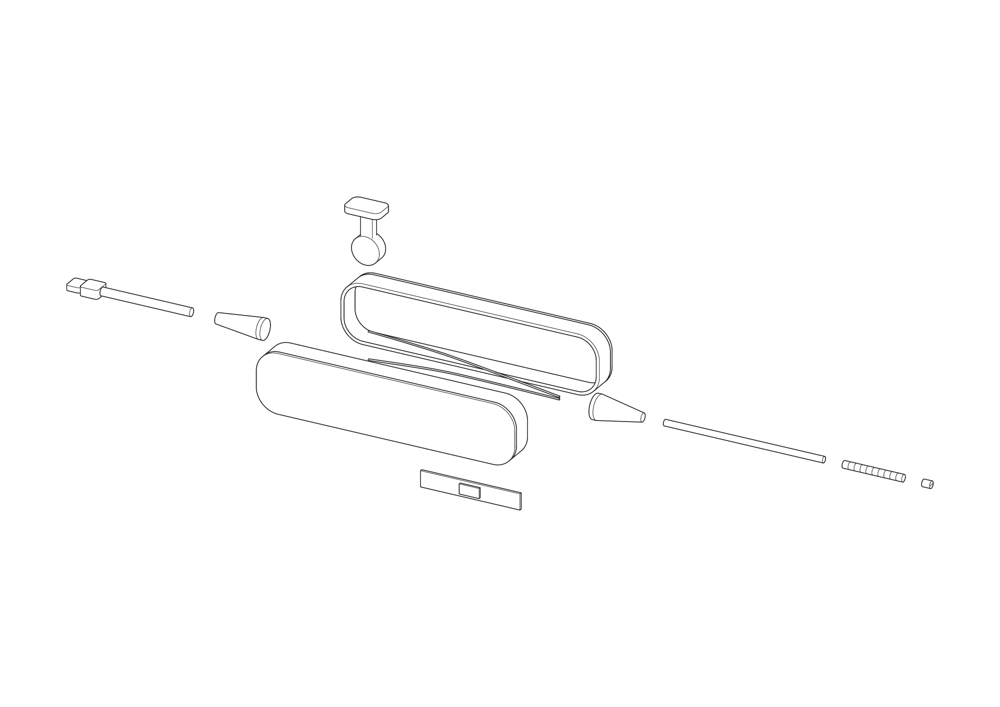
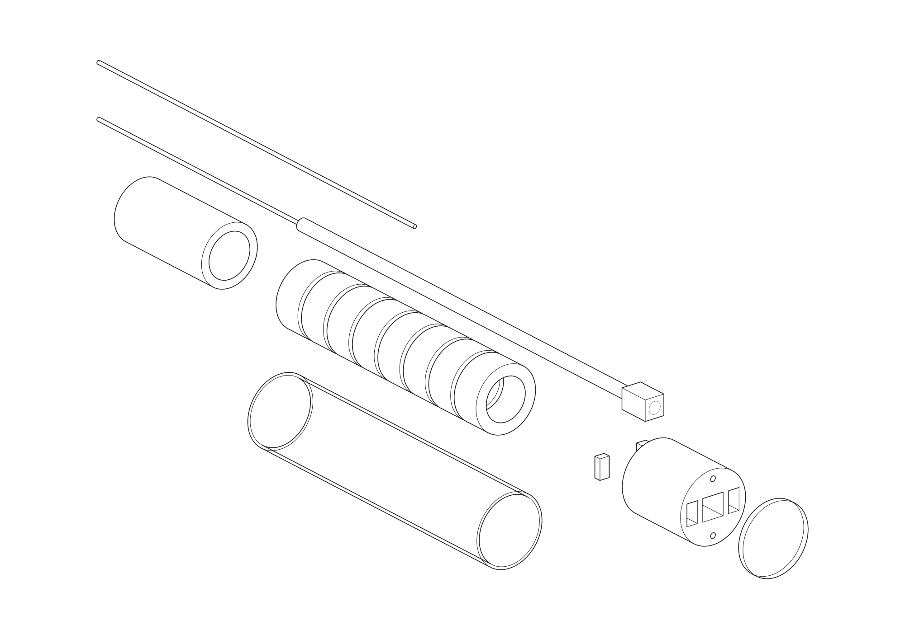
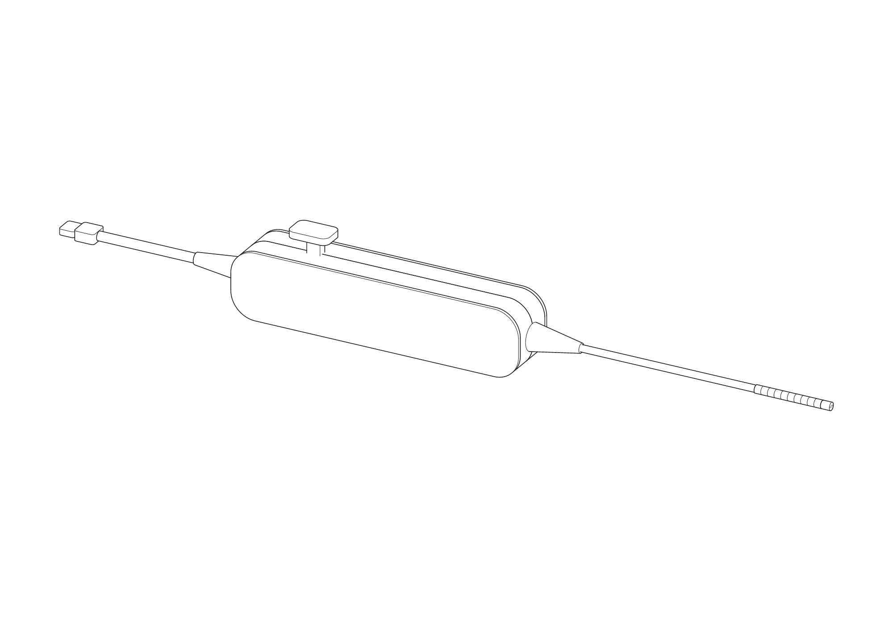
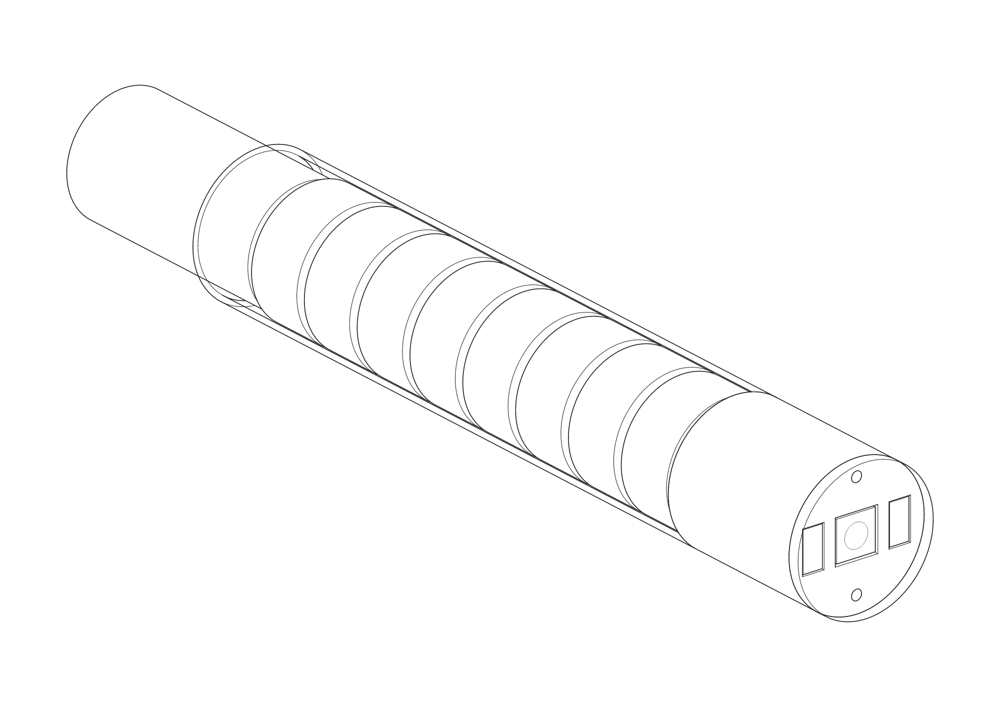

# flexscope-blueprint

Concept blueprint: cheap single-use flexible rhinolaryngoscope ("nose scope" ENTs pass through nose to see larynx). Exploded + assembled teardown drawings, BOM, cost-down plan, path to regulated device.

**Concept only.** Not a medical device, not cleared, not for patient use. Dims estimated unless cited. Drawings not to scale (NTS).

Site: survey (image quality test, send to ENTs): https://flexscope.juntotechnologies.com/quality/

Site: https://flexscope.juntotechnologies.com/ (one screen: live exploded/assembled drawing w/ labels + tabbed spec). Local viewer: `dist/index.html` (offline; exploded/assembled, part labels, color, SVG/PNG/PDF export).

## Drawings

| Whole scope, exploded | Distal tip, exploded |
|---|---|
|  |  |
|  |  |

## Target spec

Benchmark = Ambu aScope 4 RhinoLaryngo Slim (single-use market reference; values per Ambu spec page).

| Item | Ambu Slim | This concept |
|---|---|---|
| Insertion cord OD | 3.0 mm | 3.0 mm |
| Distal end OD | 3.5 mm | 3.5 mm |
| Working length | 300 mm | 300 mm |
| Bending | 130° up / 130° down | 130° up / down target, 2 pull wires |
| Working channel | none | none |
| Display | Ambu aView monitor (proprietary) | any phone/tablet/laptop via USB UVC (USB Video Class = standard webcam protocol; no driver, no monitor to buy) |

## How it works (parts = drawing labels)

| Part | Job | Cheap build route |
|---|---|---|
| Distal tip (camera + LEDs) | Image + light at tip | 3.5 mm molded housing; wafer-level CMOS camera; 2 white LEDs beside it |
| Camera module + cable | Sensor | OmniVision OVM6948: 0.65 × 0.65 × 1.158 mm, 200 × 200 px, 120° FOV, analog out, single-use target (OVM6948 brief). Hi-res alt: OV6946-class 400 × 400 (est.) |
| Cover window | Seal + optical face | Clear PC/PMMA disc, UV-cure glued |
| Bending links (×8) | Flex in 1 plane | Stainless/nitinol rings, or 1 laser-cut notched hypotube (fewer parts) |
| Pull wires (×2) | Steer tip up/down | Stainless or PE (Dyneema) braid, anchored in tip housing, wound on drum |
| Bending sheath | Smooth seal over links | Thin TPU/PEBAX sleeve |
| Insertion cord | Carry wires + cable | PEBAX/TPU multi-lumen extrusion, 3.0 mm |
| Nose strain relief | Kink guard at handle | Overmolded TPU |
| Handle shell L/R | Grip + enclosure | 2 injection-molded ABS/PC halves, snap or ultrasonic weld |
| Angulation lever + drum | Thumb → wire pull | 1 molded part; detent friction pad |
| USB video bridge board | Sensor → UVC video, LED drive | Small PCB: sensor companion/ISP + UVC bridge chip + LED current driver |
| Cable strain relief + USB-C cable | Power + video to host | Off-the-shelf USB-C cable, overmolded boot |

## Cost-down levers (vs single-use incumbents)

1. No monitor: UVC → any existing screen. Biggest system-cost cut.
2. Wafer-level camera (no separate lens assembly).
3. LEDs at tip, no fiber bundle.
4. 2-way (up/down) bending only; user rotates handle for left/right.
5. No working channel (diagnostic only) → 3.0 mm cord, simpler extrusion.
6. 2-part molded handle, 1-part lever/drum, no screws.
7. Notched hypotube option replaces 8 links + rivets.

Unit costs: **not yet quoted**. Get quotes (OmniVision distributor, extrusion house, molder) before any $ target. No price here is sourced yet.

## Bench prototype cost (rough)

Goal: cheapest working bench unit (bends + streams video). **Not for human use** (not sterile, materials not biocompatible). $ = 1 unit, USD. **L** = seen in a listing (snippet, unverified, see Sources); **E** = estimate/guess.

| Part | Cheapest route | $ | Basis |
|---|---|---|---|
| Camera + LEDs + USB | 3.9 mm USB endoscope module, 6 LEDs, UVC (or gut a ~$25 3.9 mm USB borescope) | 20 | L |
| Bending section | Notched tube: 4 mm PTFE or thin-wall steel tube, hand-cut slots (FDM can't print 4 mm links) | 2–10 | E |
| Pull wires ×2 | 0.2–0.3 mm stainless leader wire / guitar string | 2 | E |
| Insertion cord | 4 mm OD PTFE tube (camera cable + 2 small wire liners inside) | 2 | L (~£4/m) |
| Outer sleeve + seal | Thin heat-shrink / silicone sleeve over bend; UV glue at tip | 3 | E |
| Handle shells, lever, drum | 3D-printed PETG, ~50 g | 1 | E (~$20/kg) |
| Screws, spring, detent | M2/M3 hardware | 1 | E |
| Display | Phone/laptop via USB-C OTG + free UVC app | 0 | — |
| **Per unit** | | **~30–40** | E |
| One-time | Packs (wire, heat-shrink, glue, screws), small files/Dremel bits | ~30–50 | E |

Biggest gaps vs real device: 3.9 mm tip (target 3.5); off-the-shelf module not medical; LED tip heat unmeasured; no sterilization. Cheapest 3.5 mm-class path = OVM6948/OVM6946 module (~$64 bare at 200+ qty, L) + own USB bridge board → cost up, size down.

Order of work: 1 module + PTFE tube + wire → bend test on bench → print handle around it.

## Path to real device (US)

Device type = nasopharyngoscope; expect FDA Class II, 510(k) (verify product code + predicate before planning). Typical evidence stack (verify per predicate):

| Area | Standard |
|---|---|
| Biocompat (mucosal contact) | ISO 10993 |
| Sterilization (likely EtO) | ISO 11135 |
| Electrical safety | IEC 60601-1, -1-2 (EMC), -2-18 (endoscopic equip.) |
| Usability | IEC 62366-1 |
| Firmware | IEC 62304 |
| Quality system | ISO 13485 |

## Build sequence

1. Bench prototype: off-the-shelf 2–3.9 mm USB borescope camera + 3D-printed handle + notched tube → prove bending + image.
2. Swap to OVM6948-class sensor + custom bridge board at 3.5 mm.
3. Molded handle + extruded cord; DFM (design for manufacture) review.
4. Verification testing vs table above; 510(k).

## Repo

| Path | What |
|---|---|
| `drawing/data.json` | SSOT: dims, parts, explosions, titles |
| `drawing/scope.js`, `drawing/tip.js` | 3D models |
| `evidence.md` | Per-feature evidence class (sourced / estimated / illustrative) |
| `dist/index.html` | Built viewer |
| `site/`, `tools/site/` | Pages site: template + build (README → page) + viewport shots |
| `tools/teardown/`, `.agents/skills/teardown/` | Teardown skill (from bench-bridge) |

Cmds: `npm i` → `npm run proof` → `npm run check` → `npm run site`.

## Sources

- [Ambu aScope 4 RhinoLaryngo Slim spec](https://www.ambu.co.uk/endoscopy/ent-otorhinolaryngology/rhinolaryngoscopes/product/ambu-ascope-4-rhinolaryngo-slim)
- [Ambu aScope 4 RhinoLaryngo Slim, FDA GUDID](https://accessgudid.nlm.nih.gov/devices/05707480146284)
- [OmniVision OVM6948 product brief](https://www.ovt.com/wp-content/uploads/2023/03/OVM6948-PB-v1.5-WEB.pdf)
- Prototype listings (search snippets 2026-11-01, unverified): [3.9 mm USB endoscope module, Made-in-China](https://m.made-in-china.com/hot-china-products/Endoscope_Camera_Module.html); [3.9 mm USB borescope, eBay](https://www.ebay.de/itm/256364661303); [PTFE 3×4 mm tube, TF Pumps](https://tfpumps.com/product/3-0mm-ptfe-tubing-4-0mm-od-30m-length/); [OVM6946 bulk, LCSC](https://fat.lcsc.com/product-detail/C5182180.html)
